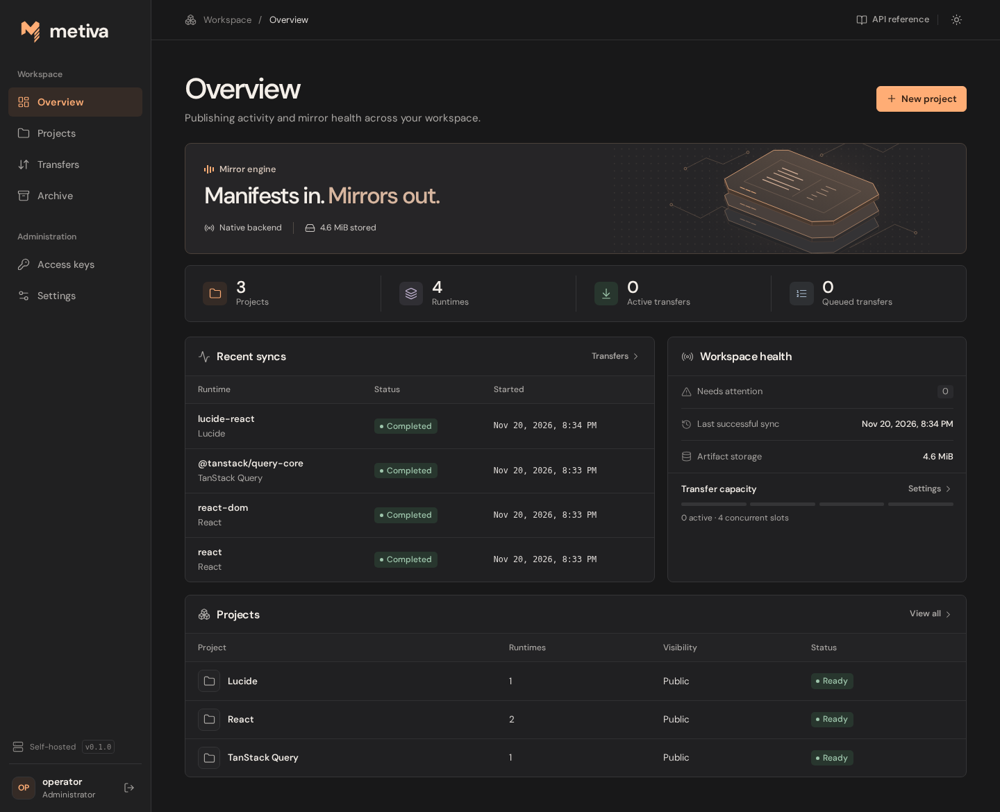

<p align="center">
  <picture>
    <source media="(prefers-color-scheme: dark)" srcset="assets/brand/wordmark-dark.svg">
    
  </picture>
</p>
<p align="center"><strong>Manifests in. Mirrors out.</strong></p>

Metiva mirrors artifacts from JSON release feeds. Inspect a feed, start a sync, and give consumers a stable manifest on your own domain. Each runtime keeps a cumulative library. When an upstream drops a version, its verified files stay available at their existing mirror URLs.



## Run a mirror

Use a Linux host with Docker Compose, local disk storage and an existing external Docker network named `prod-frontend`. Run these commands from the checkout as the account that will own the data.

```sh
git clone https://github.com/ImJstNickDev/metiva.git
cd metiva
cp .env.example .env
install -d -m 700 data
install -d -m 755 data/artifacts
```

Set `METIVA_PUBLIC_URL` in `.env` to your external HTTPS origin. Set `METIVA_UID` and `METIVA_GID` to the numbers printed by `id -u` and `id -g`. When using a different data directory, create its `artifacts` subdirectory before starting.

```sh
docker compose config --quiet
docker compose up -d --build
docker compose ps
cat data/bootstrap-secret
```

In Nginx Proxy Manager, create a proxy host for the configured domain. Select **HTTP**, forward to **metiva** on port **80**, and enable HTTPS on the public host. Open the dashboard over HTTPS. Enter the local bootstrap secret and choose the administrator username and password. Setup consumes the secret.

## Publish a runtime

1. In **Projects**, create a project and a runtime. Choose visibility explicitly when you want anonymous downloads.
2. Import a manifest URL or upload JSON. Choose a release list or linked index, select the channels and artifact groups to follow, then preview the exact files and known download size. Edit that selection later to include new platforms or channels.
3. Add the source and start synchronization. **Transfers** shows observed bytes, verification and retries.
4. Copy the published endpoint from the runtime. Consumers can fetch the manifest at `/p/{project}/r/{runtime}/manifest.json`. A compatible single feed can also provide `upstream.json`.
5. Select a filename in **Publication** for its revision timeline. A verified correction takes over its existing URL. An administrator can download earlier bytes from the timeline.
6. Park a runtime or project to take its endpoints offline. Restore it from **Archive** to serve its preserved publication again.

For a private runtime, create a read key in **Access Keys**. Select the narrowest scope your consumer needs. The dashboard shows the secret once. Supply it in an HTTP header.

```sh
curl --fail --header "Authorization: Bearer ${METIVA_KEY}" \
  "${METIVA_PUBLIC_URL}/p/atlas/r/linux/manifest.json"
```

The consumer contract is available from your instance at `/api/v1/openapi.json`. See [API and manifest formats](docs/api.md) for a sample source, mapping and authorization rules.

## Operate and develop

The API and worker share SQLite and a content-addressed artifact store. Nginx streams authorized files with Range support. Container recreation preserves bind-mounted data. [Storage, recovery and upgrades](docs/deployment.md)

Use the pinned Rust toolchain and Node.js 22 or newer.

```sh
cargo test --locked --workspace
(cd apps/web && npm ci && npm test && npm run build)
python3 tests/compose/run.py
```

The Compose test creates a temporary data directory, test origin and TLS proxy. It exercises publication, interrupted transfer recovery, archive access and credential rotation end to end. It requires Docker with Compose v2.24+ and OpenSSL.

Versioned Linux amd64 ingress and service images are available on GHCR. [Deploy prebuilt images](docs/deployment.md#versioned-images)

The [contributor guide](CONTRIBUTING.md) covers local API, worker and dashboard development.

## License

Metiva is available under the [MIT license](LICENSE).
